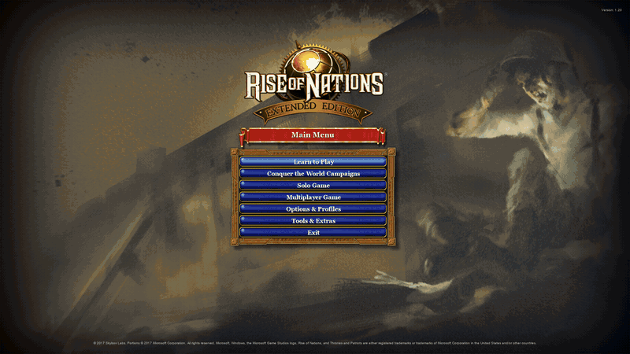

# Rise of Nations: Extended Edition — Static Recompilation

Static recompilation of **Rise of Nations: Extended Edition** (Big Huge Games
/ Microsoft, 2003; the 2014 Extended Edition, Steam build of 2024-06-20) from
its shipping Win32 executable, `riseofnations.exe`, to native C, compiled
fresh and run natively on Windows. The whole exe lifts: 73,895 functions,
0 errors.

Built on the [pcrecomp](https://github.com/sp00nznet/pcrecomp) toolchain, the
same way as [Red Alert 2](https://github.com/sp00nznet/redalert2-recomp). This
runs Big Huge Games' own code, recompiled; it is not a reimplementation.



*Recorded headlessly from the recompiled game: the main menu, then a quick
battle as China.*

The point is more than parity. The Extended Edition crashes for a lot of
players; with the whole exe as C we can find out why and fix it
([docs/crashes.md](docs/crashes.md)).

**This is an unofficial fan project, not affiliated with Microsoft, Big Huge
Games or Skybox Labs.** No game files are in this repository, and neither is
the generated C: you supply your own copy and everything is built on your
machine.

## Already better than the original

- **4 GB of address space.** `riseofnations.exe` is not Large Address Aware,
  and the most reported in-game crash, `Cant create vertex buffer
  !:outofmem` in long matches, is its 2 GB limit. `ron.exe` is linked
  `/LARGEADDRESSAWARE`, by construction.
- **Runs over Remote Desktop**, which the shipping renderer refuses.

## Getting started

You need **your own copy of Rise of Nations: Extended Edition** from Steam.
Nothing from the game is in this repository or downloaded for you.

1. Download this repository (the green **Code** button, then **Download
   ZIP**) and unzip it somewhere with 8 GB free.
2. Double-click **`Setup.cmd`**.
3. Play with **`Rise of Nations (recomp).cmd`** in that folder.

The script asks before installing anything (Python 3.10+ with `pefile` and
`capstone`, the pcrecomp toolkit, Visual Studio 2022's C++ Build Tools, CMake
and Ninja). It finds the game in your Steam library (or asks for the folder),
copies only `riseofnations.exe` into `work\`, then catalogs, lifts and builds;
the game itself stays where Steam put it. The first run takes one to two
hours, once; a rerun skips finished steps.

**Set the in-game resolution to your desktop's.** Any other resolution
switches the monitor's mode, and on a multi-monitor setup every screen
cycles.

### By hand

With pcrecomp's `ron-build` branch cloned beside this repository as `tools\`:

```
py -3 -m pip install --user pefile capstone
copy "<install>\riseofnations.exe" work\
py -3 ..\tools\tools\pe\pe_analyze.py work\riseofnations.exe --json work\pe_analysis.json
py -3 ..\tools\tools\cpp\rtti.py work\riseofnations.exe -o work\rtti.json --seeds work\rtti_seeds.json
py -3 ..\tools\tools\disasm\disasm32.py work\riseofnations.exe -o work\functions.json --seed-functions work\rtti_seeds.json
py -3 run_lift.py --all
build.cmd
build\ron.exe --run --game "<install>"
```

`--headless --mute` runs it on a hidden window with no sound;
`tools\hidden_run.py` puts a test run on a private desktop and records frames
(see its header). `py -3 tools\conformance.py` checks boot milestones and lift
health against `conformance.json`.

## Status

**Playable, early.** It boots, every menu works, and quick and custom battles
load and play: the world, units, buildings, selection and build menus. Tested
on one machine so far; long matches, campaigns, saves and multiplayer are not
yet.

| Stage | State |
|---|---|
| Function catalog (`disasm32`) | 73,869 functions, 97.0% of `.text` |
| Lift (`run_lift.py --all`) | 73,895 functions, 19.7M lines of C, 0 errors |
| RTTI | 1,339 classes, 1,716 vtables, 3,977 virtual methods |
| Boot, menus, battles | working ([bringup.md](docs/bringup.md)) |
| Known crashes | 13 collected with sources ([crashes.md](docs/crashes.md)) |

Not in scope yet: multiplayer and the online stack (PlayFab, Crossplay,
SignalR), Twitch, the `patriots.exe` launcher, the Workshop, Linux
([ROADMAP.md](ROADMAP.md)).

## Documentation

- [docs/triage.md](docs/triage.md): why this game, and what was there to start from
- [docs/RECON.md](docs/RECON.md): the binary, the build and the class map
- [docs/bringup.md](docs/bringup.md): every wall so far and its fix
- [docs/crashes.md](docs/crashes.md): the Extended Edition's known crashes, with sources
- [ROADMAP.md](ROADMAP.md), [CHANGELOG.md](CHANGELOG.md), [CONTRIBUTING.md](CONTRIBUTING.md), [PROVENANCE.md](PROVENANCE.md)

## License

MIT for this repository's own code ([LICENSE](LICENSE)). Rise of Nations is
© Microsoft; none of its files, and nothing generated from them, is in this
repository.
